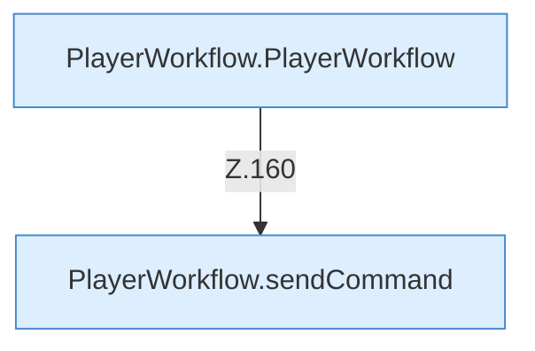

[[00 Start]] › [[Dashboard-UI]] › [[UI-Workflows]] › [[PlayerWorkflow]]

# PlayerWorkflow



```knoten
PlayerWorkflow.sendCommand
  Die [[Glossar#Bedienseite|Bedienseite]] schickt den [[Glossar#Befehl|Befehl]]. Im [[Glossar#Quelltext|Quelltext]] heißt das `sendCommand`.
PlayerWorkflow.PlayerWorkflow
  Die [[Glossar#Bedienseite|Bedienseite]] kümmert sich um den Ablauf. Im [[Glossar#Quelltext|Quelltext]] heißt das `PlayerWorkflow`.
```

> [!knoten]- Was die Blöcke tun
> - **PlayerWorkflow.sendCommand**: Die [[Glossar#Bedienseite|Bedienseite]] schickt den [[Glossar#Befehl|Befehl]]. Im [[Glossar#Quelltext|Quelltext]] heißt das `sendCommand`.
> - **PlayerWorkflow.PlayerWorkflow**: Die [[Glossar#Bedienseite|Bedienseite]] kümmert sich um den Ablauf. Im [[Glossar#Quelltext|Quelltext]] heißt das `PlayerWorkflow`.

- Der Ablauf in der [[Glossar#Bedienseite|Bedienseite]], mit dem man etwas für einen [[Glossar#Spieler|Spieler]] tut.
