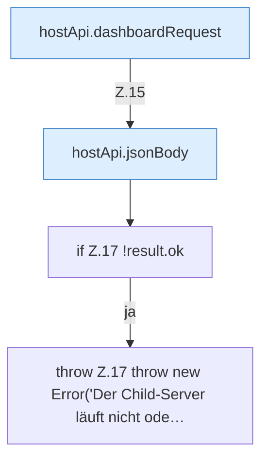

[[00 Start]] › [[Dashboard-UI]] › [[UI-Workflows]] › [[PlayerWorkflow]] › [[PlayerWorkflow.sendCommand]]

# PlayerWorkflow.sendCommand

`PlayerWorkflow.sendCommand(command: string)` [ui/src/components/PlayerWorkflow.tsx:12–18](https://github.com/Sciddie/minecraft-serverhoster-plugin/blob/95b02b953b0b4c23673e900e021a7c3c844aa37d/ui/src/components/PlayerWorkflow.tsx#L12-L18)

- `sendCommand` in `ui/src/components/PlayerWorkflow.tsx`
