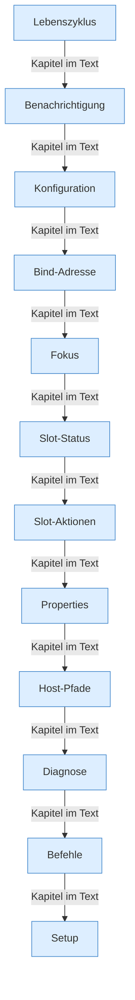

[[00 Start]] › [[Plugin-Kern]]

# Plugin-Kern



```knoten
Lebenszyklus
  Was passiert, wenn der [[Glossar#Host|Host]] das [[Glossar#Plugin|Plugin]] lädt, einschaltet und wieder ausschaltet. Hier starten auch die [[Glossar#Wecker|Wecker]].
Benachrichtigung
  Schickt eine kurze Nachricht an einen externen Mitteilungsdienst, wenn etwas passiert.
Konfiguration
  Lesen und Schreiben der [[Glossar#Einstellungen|Einstellungen]]. Stehen mehrere Server in der Datei, behält der laufende Weg nur den ersten.
Bind-Adresse
  Unter welcher Adresse und Türnummer der [[Glossar#Host|Host]], die [[Glossar#Bedienseite|Bedienseite]] und der [[Glossar#Spielserver|Spielserver]] erreichbar sind.
Fokus
  Welcher Server gerade gemeint ist. Praktisch ist es immer derselbe eine.
Slot-Status
  Ob der [[Glossar#Spielserver|Spielserver]] läuft, welche Programmnummer er hat, wie lange schon, was die [[Glossar#Konsole|Konsole]] zuletzt sagte, und wer spielt.
Slot-Aktionen
  Dem laufenden [[Glossar#Spielserver|Spielserver]] einen [[Glossar#Befehl|Befehl]] schicken, oder ihn starten, stoppen und neu starten.
Properties
  Die Eigenschaftsdatei des [[Glossar#Spielserver|Spielservers]], zum Beispiel [[Glossar#Port|Port]] und Schwierigkeit, und die Dateien der [[Glossar#Spieler|Spieler]].
Host-Pfade
  Wo die [[Glossar#Spielwelt|Spielwelt]] liegt, welches Java benutzt wird, wo die [[Glossar#Programmdatei|Programmdatei]] des [[Glossar#Plugin|Plugins]] liegt, und welche Ordner geschützt sind.
Diagnose
  Eine Übersicht zum Nachsehen: Platte, [[Glossar#Startplan|Startplan]], [[Glossar#Programmdatei|Programmdatei]], [[Glossar#Absturzbericht|Absturzberichte]] und die Dauer der [[Glossar#Spielschritt|Spielschritte]].
Befehle
  Der [[Glossar#Befehl|Befehl]] /child. Damit startet, stoppt oder prüft man den [[Glossar#Spielserver|Spielserver]]. Nur jemand mit Operator-Recht darf das.
Setup
  Die [[Glossar#Einrichtung|Einrichtung]] des [[Glossar#Spielserver|Spielservers]], das Aufräumen danach, und das Übernehmen von Dateien aus einer älteren Anlage.
```

> [!knoten] Was die Blöcke tun
> - **Lebenszyklus**: Was passiert, wenn der [[Glossar#Host|Host]] das [[Glossar#Plugin|Plugin]] lädt, einschaltet und wieder ausschaltet. Hier starten auch die [[Glossar#Wecker|Wecker]].
> - **Benachrichtigung**: Schickt eine kurze Nachricht an einen externen Mitteilungsdienst, wenn etwas passiert.
> - **Konfiguration**: Lesen und Schreiben der [[Glossar#Einstellungen|Einstellungen]]. Stehen mehrere Server in der Datei, behält der laufende Weg nur den ersten.
> - **Bind-Adresse**: Unter welcher Adresse und Türnummer der [[Glossar#Host|Host]], die [[Glossar#Bedienseite|Bedienseite]] und der [[Glossar#Spielserver|Spielserver]] erreichbar sind.
> - **Fokus**: Welcher Server gerade gemeint ist. Praktisch ist es immer derselbe eine.
> - **Slot-Status**: Ob der [[Glossar#Spielserver|Spielserver]] läuft, welche Programmnummer er hat, wie lange schon, was die [[Glossar#Konsole|Konsole]] zuletzt sagte, und wer spielt.
> - **Slot-Aktionen**: Dem laufenden [[Glossar#Spielserver|Spielserver]] einen [[Glossar#Befehl|Befehl]] schicken, oder ihn starten, stoppen und neu starten.
> - **Properties**: Die Eigenschaftsdatei des [[Glossar#Spielserver|Spielservers]], zum Beispiel [[Glossar#Port|Port]] und Schwierigkeit, und die Dateien der [[Glossar#Spieler|Spieler]].
> - **Host-Pfade**: Wo die [[Glossar#Spielwelt|Spielwelt]] liegt, welches Java benutzt wird, wo die [[Glossar#Programmdatei|Programmdatei]] des [[Glossar#Plugin|Plugins]] liegt, und welche Ordner geschützt sind.
> - **Diagnose**: Eine Übersicht zum Nachsehen: Platte, [[Glossar#Startplan|Startplan]], [[Glossar#Programmdatei|Programmdatei]], [[Glossar#Absturzbericht|Absturzberichte]] und die Dauer der [[Glossar#Spielschritt|Spielschritte]].
> - **Befehle**: Der [[Glossar#Befehl|Befehl]] /child. Damit startet, stoppt oder prüft man den [[Glossar#Spielserver|Spielserver]]. Nur jemand mit Operator-Recht darf das.
> - **Setup**: Die [[Glossar#Einrichtung|Einrichtung]] des [[Glossar#Spielserver|Spielservers]], das Aufräumen danach, und das Übernehmen von Dateien aus einer älteren Anlage.

- Das [[Glossar#Plugin|Plugin]] selbst. Es nimmt [[Glossar#Befehl|Befehle]] entgegen, liest die [[Glossar#Einstellungen|Einstellungen]] und steuert den einen [[Glossar#Spielserver|Spielserver]].
