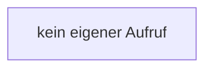

[[00 Start]] › [[Host-Betrieb]] › [[Speicher-Messung]] › [[ProcessProbe]] › [[ProcessProbe.ProcessProbe]]

# ProcessProbe.ProcessProbe

`ProcessProbe.ProcessProbe()` [src/main/java/de/aichele/childlauncher/ProcessProbe.java:21–21](https://github.com/Sciddie/minecraft-serverhoster-plugin/blob/95b02b953b0b4c23673e900e021a7c3c844aa37d/src/main/java/de/aichele/childlauncher/ProcessProbe.java#L21-L21)



```knoten
kein eigener Aufruf
  In diesem Stück gibt es keinen weiteren eigenen Aufruf.
```

- `ProcessProbe` in `src/main/java/de/aichele/childlauncher/ProcessProbe.java`
