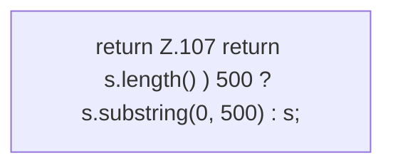

[[00 Start]] › [[Host-Betrieb]] › [[Speicher-Messung]] › [[ProcessProbe]] › [[ProcessProbe.abbreviate]]

# ProcessProbe.abbreviate

`ProcessProbe.abbreviate(String s)` [src/main/java/de/aichele/childlauncher/ProcessProbe.java:107–107](https://github.com/Sciddie/minecraft-serverhoster-plugin/blob/95b02b953b0b4c23673e900e021a7c3c844aa37d/src/main/java/de/aichele/childlauncher/ProcessProbe.java#L107-L107)



```knoten
return Z.107 return s.length() ) 500 ? s.substring(0, 500) : s;
  Zeile 107: Rückgabe `return s.length() ) 500 ? s.substring(0, 500) : s;`.
```

> [!knoten]- Was die Blöcke tun
> - **return Z.107 return s.length() ) 500 ? s.substring(0, 500) : s;**: Zeile 107: Rückgabe `return s.length() ) 500 ? s.substring(0, 500) : s;`.

- Dieser Teil macht hier einen einzelnen Schritt. Eine Ebene tiefer steht er genauer.
- `abbreviate` in `src/main/java/de/aichele/childlauncher/ProcessProbe.java`
