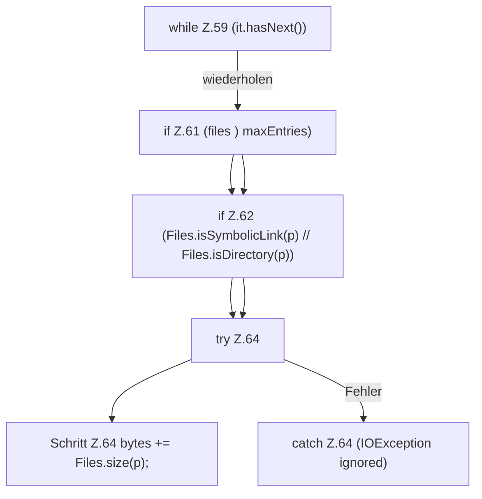

[[00 Start]] › [[Host-Betrieb]] › [[Speicher-Messung]] › [[ProcessProbe]] › [[ProcessProbe.disk]] › [[ProcessProbe.disk.Z57.Z59]]

# ProcessProbe.disk.Z57.Z59

- Fortsetzung von `ProcessProbe.disk.Z57`, Quellreihenfolge.
