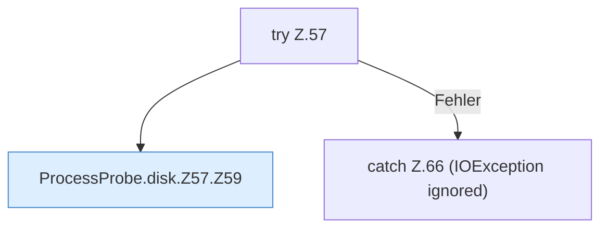

[[00 Start]] › [[Host-Betrieb]] › [[Speicher-Messung]] › [[ProcessProbe]] › [[ProcessProbe.disk]] › [[ProcessProbe.disk.Z57]]

# ProcessProbe.disk.Z57



```knoten
try Z.57
  Zeile 57: Versuch. Der Fehlerpfad geht in catch.
ProcessProbe.disk.Z57.Z59
  Fortsetzung des Ablaufs ab Zeile 59.
catch Z.66 (IOException ignored)
  Zeile 66: fängt (IOException ignored).
```

- Fortsetzung von `ProcessProbe.disk`, Quellreihenfolge.
