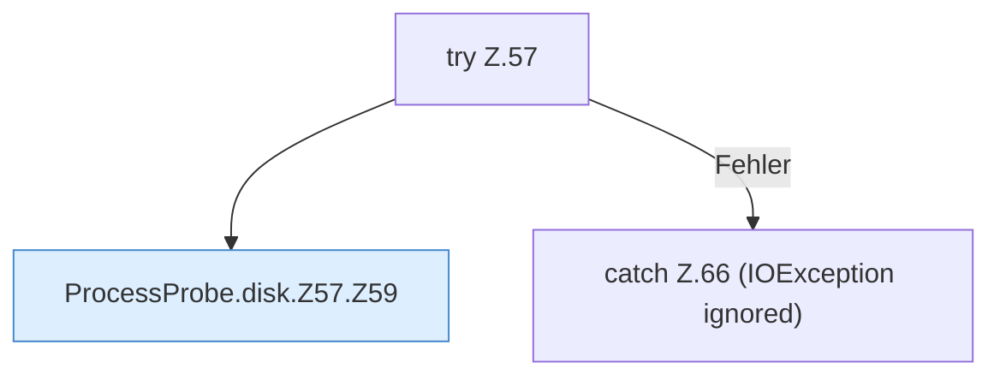

[[00 Start]] › [[Host-Betrieb]] › [[Speicher-Messung]] › [[ProcessProbe]] › [[ProcessProbe.disk]] › [[ProcessProbe.disk.Z57]]

# ProcessProbe.disk.Z57

- Fortsetzung von `ProcessProbe.disk`, Quellreihenfolge.
