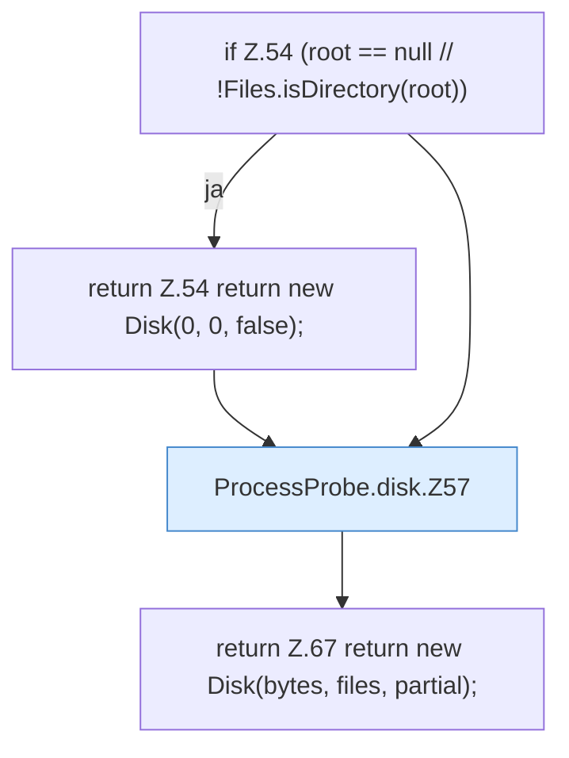

[[00 Start]] › [[Host-Betrieb]] › [[Speicher-Messung]] › [[ProcessProbe]] › [[ProcessProbe.disk]]

# ProcessProbe.disk

`ProcessProbe.disk(Path root, int maxEntries)` [src/main/java/de/aichele/childlauncher/ProcessProbe.java:53–68](https://github.com/Sciddie/minecraft-serverhoster-plugin/blob/95b02b953b0b4c23673e900e021a7c3c844aa37d/src/main/java/de/aichele/childlauncher/ProcessProbe.java#L53-L68)

- `disk` in `src/main/java/de/aichele/childlauncher/ProcessProbe.java`
