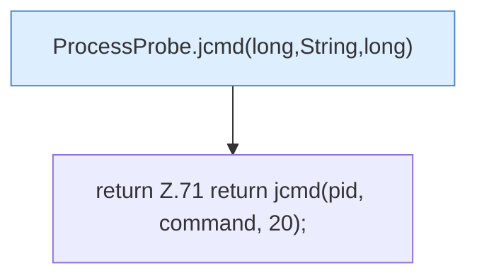

[[00 Start]] › [[Host-Betrieb]] › [[Speicher-Messung]] › [[ProcessProbe]] › [[ProcessProbe.jcmd(long,String)]]

# ProcessProbe.jcmd(long,String)

`ProcessProbe.jcmd(long pid, String command)` [src/main/java/de/aichele/childlauncher/ProcessProbe.java:70–72](https://github.com/Sciddie/minecraft-serverhoster-plugin/blob/95b02b953b0b4c23673e900e021a7c3c844aa37d/src/main/java/de/aichele/childlauncher/ProcessProbe.java#L70-L72)

- `jcmd` in `src/main/java/de/aichele/childlauncher/ProcessProbe.java`
