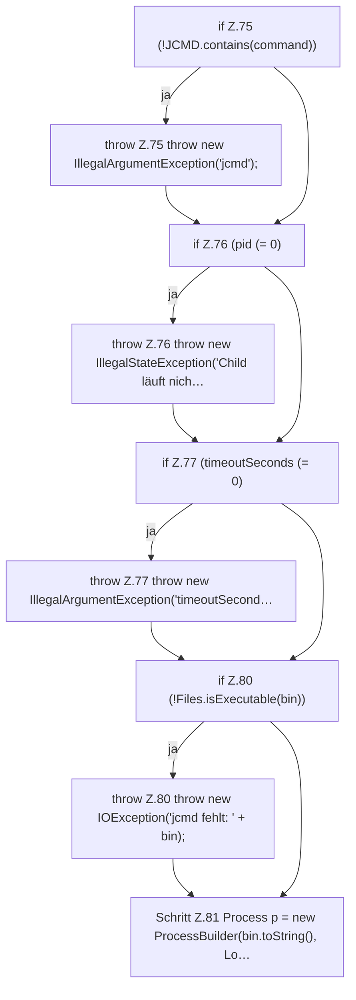

[[00 Start]] › [[Host-Betrieb]] › [[Speicher-Messung]] › [[ProcessProbe]] › [[ProcessProbe.jcmd(long,String,long)]] › [[ProcessProbe.jcmd(long,String,long).Teil1]]

# ProcessProbe.jcmd(long,String,long).Teil1

- Fortsetzung von `ProcessProbe.jcmd(long,String,long)`, Quellreihenfolge.
