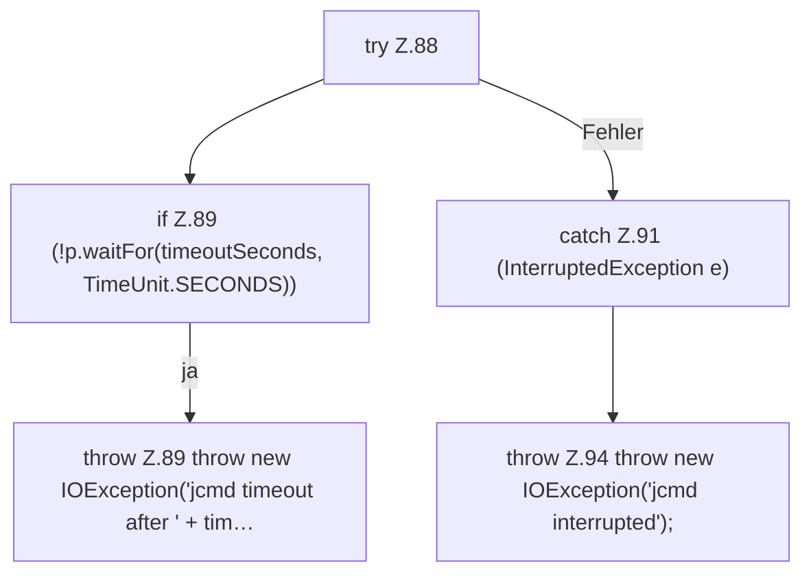

[[00 Start]] › [[Host-Betrieb]] › [[Speicher-Messung]] › [[ProcessProbe]] › [[ProcessProbe.jcmd(long,String,long)]] › [[ProcessProbe.jcmd(long,String,long).Teil2.Z88]]

# ProcessProbe.jcmd(long,String,long).Teil2.Z88



```knoten
try Z.88
  Zeile 88: Versuch. Der Fehlerpfad geht in catch.
if Z.89 (!p.waitFor(timeoutSeconds, TimeUnit.SECONDS))
  Zeile 89: prüft `(!p.waitFor(timeoutSeconds, TimeUnit.SECONDS))`.
throw Z.89 throw new IOException('jcmd timeout after ' + tim…
  Zeile 89: Abbruch `throw new IOException('jcmd timeout after ' + tim…`.
catch Z.91 (InterruptedException e)
  Zeile 91: fängt (InterruptedException e).
throw Z.94 throw new IOException('jcmd interrupted');
  Zeile 94: Abbruch `throw new IOException('jcmd interrupted');`.
```

- Fortsetzung von `ProcessProbe.jcmd(long,String,long).Teil2`, Quellreihenfolge.
