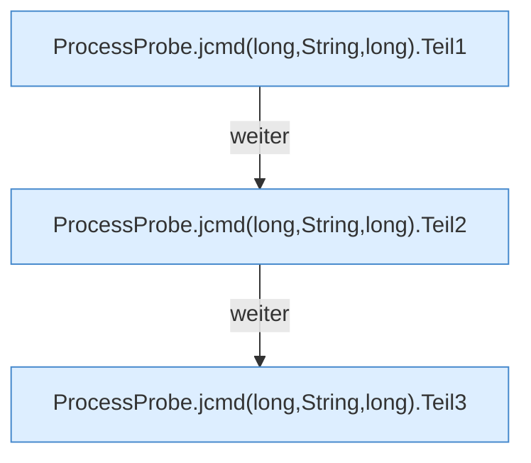

[[00 Start]] › [[Host-Betrieb]] › [[Speicher-Messung]] › [[ProcessProbe]] › [[ProcessProbe.jcmd(long,String,long)]]

# ProcessProbe.jcmd(long,String,long)

`ProcessProbe.jcmd(long pid, String command, long timeoutSeconds)` [src/main/java/de/aichele/childlauncher/ProcessProbe.java:74–100](https://github.com/Sciddie/minecraft-serverhoster-plugin/blob/95b02b953b0b4c23673e900e021a7c3c844aa37d/src/main/java/de/aichele/childlauncher/ProcessProbe.java#L74-L100)

- `jcmd` in `src/main/java/de/aichele/childlauncher/ProcessProbe.java`
