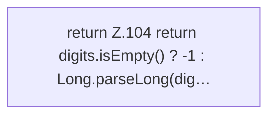

[[00 Start]] › [[Host-Betrieb]] › [[Speicher-Messung]] › [[ProcessProbe]] › [[ProcessProbe.kb]]

# ProcessProbe.kb

`ProcessProbe.kb(String line)` [src/main/java/de/aichele/childlauncher/ProcessProbe.java:102–105](https://github.com/Sciddie/minecraft-serverhoster-plugin/blob/95b02b953b0b4c23673e900e021a7c3c844aa37d/src/main/java/de/aichele/childlauncher/ProcessProbe.java#L102-L105)



```knoten
return Z.104 return digits.isEmpty() ? -1 : Long.parseLong(dig…
  Zeile 104: Rückgabe `return digits.isEmpty() ? -1 : Long.parseLong(dig…`.
```

> [!knoten]- Was die Blöcke tun
> - **return Z.104 return digits.isEmpty() ? -1 : Long.parseLong(dig…**: Zeile 104: Rückgabe `return digits.isEmpty() ? -1 : Long.parseLong(dig…`.

- Dieser Teil macht hier einen einzelnen Schritt. Eine Ebene tiefer steht er genauer.
- `kb` in `src/main/java/de/aichele/childlauncher/ProcessProbe.java`
