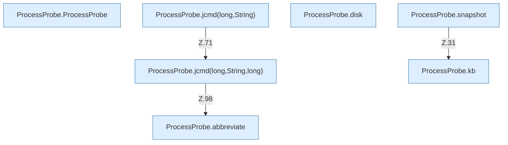

[[00 Start]] › [[Host-Betrieb]] › [[Speicher-Messung]] › [[ProcessProbe]]

# ProcessProbe



```knoten
ProcessProbe.ProcessProbe
  Dieser Teil kümmert sich um die Messung. Im [[Glossar#Quelltext|Quelltext]] heißt das `ProcessProbe`.
ProcessProbe.snapshot
  Dieser Teil macht hier einen einzelnen Schritt. Eine Ebene tiefer steht er genauer. Im [[Glossar#Quelltext|Quelltext]] heißt das `snapshot`.
ProcessProbe.disk
  Dieser Teil macht hier einen einzelnen Schritt. Eine Ebene tiefer steht er genauer. Im [[Glossar#Quelltext|Quelltext]] heißt das `disk`.
ProcessProbe.jcmd(long,String)
  Dieser Teil macht hier einen einzelnen Schritt. Eine Ebene tiefer steht er genauer. Im [[Glossar#Quelltext|Quelltext]] heißt das `jcmd(long,String)`.
ProcessProbe.jcmd(long,String,long)
  Dieser Teil macht hier einen einzelnen Schritt. Eine Ebene tiefer steht er genauer. Im [[Glossar#Quelltext|Quelltext]] heißt das `jcmd(long,String,long)`.
ProcessProbe.kb
  Dieser Teil macht hier einen einzelnen Schritt. Eine Ebene tiefer steht er genauer. Im [[Glossar#Quelltext|Quelltext]] heißt das `kb`.
ProcessProbe.abbreviate
  Dieser Teil macht hier einen einzelnen Schritt. Eine Ebene tiefer steht er genauer. Im [[Glossar#Quelltext|Quelltext]] heißt das `abbreviate`.
```

> [!knoten]- Was die Blöcke tun
> - **ProcessProbe.ProcessProbe**: Dieser Teil kümmert sich um die Messung. Im [[Glossar#Quelltext|Quelltext]] heißt das `ProcessProbe`.
> - **ProcessProbe.snapshot**: Dieser Teil macht hier einen einzelnen Schritt. Eine Ebene tiefer steht er genauer. Im [[Glossar#Quelltext|Quelltext]] heißt das `snapshot`.
> - **ProcessProbe.disk**: Dieser Teil macht hier einen einzelnen Schritt. Eine Ebene tiefer steht er genauer. Im [[Glossar#Quelltext|Quelltext]] heißt das `disk`.
> - **ProcessProbe.jcmd(long,String)**: Dieser Teil macht hier einen einzelnen Schritt. Eine Ebene tiefer steht er genauer. Im [[Glossar#Quelltext|Quelltext]] heißt das `jcmd(long,String)`.
> - **ProcessProbe.jcmd(long,String,long)**: Dieser Teil macht hier einen einzelnen Schritt. Eine Ebene tiefer steht er genauer. Im [[Glossar#Quelltext|Quelltext]] heißt das `jcmd(long,String,long)`.
> - **ProcessProbe.kb**: Dieser Teil macht hier einen einzelnen Schritt. Eine Ebene tiefer steht er genauer. Im [[Glossar#Quelltext|Quelltext]] heißt das `kb`.
> - **ProcessProbe.abbreviate**: Dieser Teil macht hier einen einzelnen Schritt. Eine Ebene tiefer steht er genauer. Im [[Glossar#Quelltext|Quelltext]] heißt das `abbreviate`.

- Fragt das laufende Programm über ein Hilfswerkzeug des Java nach seinem Zustand. Die Frage wartet höchstens zwanzig Sekunden.
