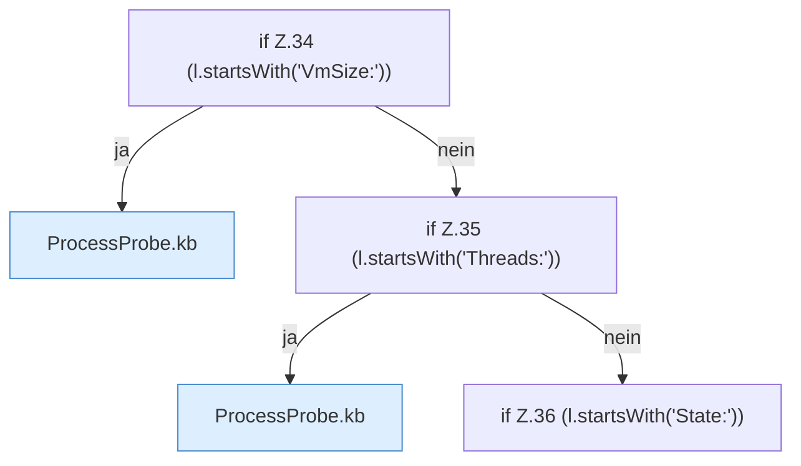

[[00 Start]] › [[Host-Betrieb]] › [[Speicher-Messung]] › [[ProcessProbe]] › [[ProcessProbe.snapshot]] › [[ProcessProbe.snapshot.Teil2.Z29.Z30.Z31.Z32.Z33.Z34]]

# ProcessProbe.snapshot.Teil2.Z29.Z30.Z31.Z32.Z33.Z34



```knoten
if Z.34 (l.startsWith('VmSize:'))
  Zeile 34: prüft `(l.startsWith('VmSize:'))`.
ProcessProbe.kb
  Dieser Teil macht hier einen einzelnen Schritt. Eine Ebene tiefer steht er genauer. `kb` in `ProcessProbe.java`.
if Z.35 (l.startsWith('Threads:'))
  Zeile 35: prüft `(l.startsWith('Threads:'))`.
if Z.36 (l.startsWith('State:'))
  Zeile 36: prüft `(l.startsWith('State:'))`.
```

> [!knoten]- Was die Blöcke tun
> - **if Z.34 (l.startsWith('VmSize:'))**: Zeile 34: prüft `(l.startsWith('VmSize:'))`.
> - **ProcessProbe.kb**: Dieser Teil macht hier einen einzelnen Schritt. Eine Ebene tiefer steht er genauer. `kb` in `ProcessProbe.java`.
> - **if Z.35 (l.startsWith('Threads:'))**: Zeile 35: prüft `(l.startsWith('Threads:'))`.
> - **if Z.36 (l.startsWith('State:'))**: Zeile 36: prüft `(l.startsWith('State:'))`.

- Der Ablauf geht in [[Glossar#Zeile|Zeile]] 34 weiter. Eine Ebene tiefer steht er genauer.
- Fortsetzung von `ProcessProbe.snapshot.Teil2.Z29.Z30.Z31.Z32.Z33`.
