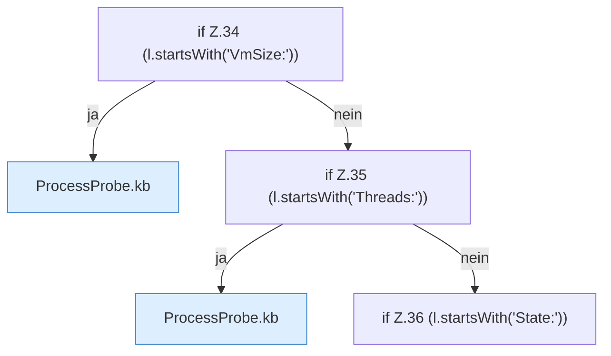

[[00 Start]] › [[Host-Betrieb]] › [[Speicher-Messung]] › [[ProcessProbe]] › [[ProcessProbe.snapshot]] › [[ProcessProbe.snapshot.Teil2.Z29.Z30.Z31.Z32.Z33.Z34]]

# ProcessProbe.snapshot.Teil2.Z29.Z30.Z31.Z32.Z33.Z34

- Fortsetzung von `ProcessProbe.snapshot.Teil2.Z29.Z30.Z31.Z32.Z33`, Quellreihenfolge.
