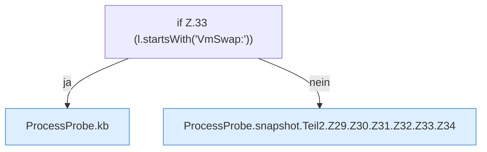

[[00 Start]] › [[Host-Betrieb]] › [[Speicher-Messung]] › [[ProcessProbe]] › [[ProcessProbe.snapshot]] › [[ProcessProbe.snapshot.Teil2.Z29.Z30.Z31.Z32.Z33]]

# ProcessProbe.snapshot.Teil2.Z29.Z30.Z31.Z32.Z33



```knoten
if Z.33 (l.startsWith('VmSwap:'))
  Zeile 33: prüft `(l.startsWith('VmSwap:'))`.
ProcessProbe.kb
  Dieser Teil macht hier einen einzelnen Schritt. Eine Ebene tiefer steht er genauer. `kb` in `ProcessProbe.java`.
ProcessProbe.snapshot.Teil2.Z29.Z30.Z31.Z32.Z33.Z34
  Der Ablauf geht in [[Glossar#Zeile|Zeile]] 34 weiter. Eine Ebene tiefer steht er genauer. Fortsetzung des Ablaufs ab Zeile 34.
```

> [!knoten]- Was die Blöcke tun
> - **if Z.33 (l.startsWith('VmSwap:'))**: Zeile 33: prüft `(l.startsWith('VmSwap:'))`.
> - **ProcessProbe.kb**: Dieser Teil macht hier einen einzelnen Schritt. Eine Ebene tiefer steht er genauer. `kb` in `ProcessProbe.java`.
> - **ProcessProbe.snapshot.Teil2.Z29.Z30.Z31.Z32.Z33.Z34**: Der Ablauf geht in [[Glossar#Zeile|Zeile]] 34 weiter. Eine Ebene tiefer steht er genauer. Fortsetzung des Ablaufs ab Zeile 34.

- Der Ablauf geht in [[Glossar#Zeile|Zeile]] 33 weiter. Eine Ebene tiefer steht er genauer.
- Fortsetzung von `ProcessProbe.snapshot.Teil2.Z29.Z30.Z31.Z32`.
