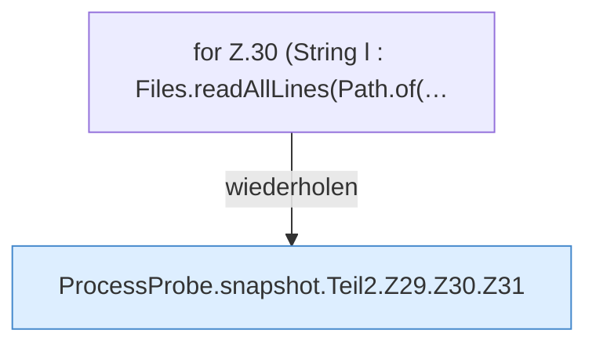

[[00 Start]] › [[Host-Betrieb]] › [[Speicher-Messung]] › [[ProcessProbe]] › [[ProcessProbe.snapshot]] › [[ProcessProbe.snapshot.Teil2.Z29.Z30]]

# ProcessProbe.snapshot.Teil2.Z29.Z30



```knoten
for Z.30 (String l : Files.readAllLines(Path.of(…
  Zeile 30: Schleife `(String l : Files.readAllLines(Path.of(…`.
ProcessProbe.snapshot.Teil2.Z29.Z30.Z31
  Fortsetzung des Ablaufs ab Zeile 31.
```

- Fortsetzung von `ProcessProbe.snapshot.Teil2.Z29`, Quellreihenfolge.
