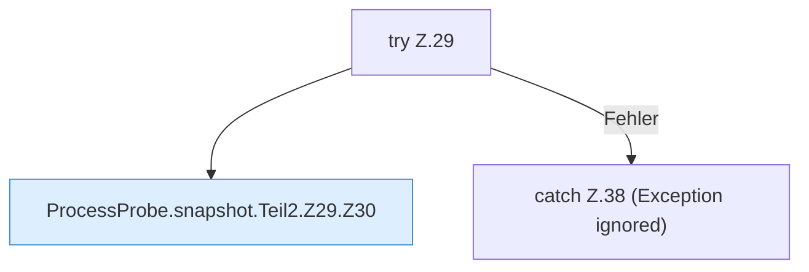

[[00 Start]] › [[Host-Betrieb]] › [[Speicher-Messung]] › [[ProcessProbe]] › [[ProcessProbe.snapshot]] › [[ProcessProbe.snapshot.Teil2.Z29]]

# ProcessProbe.snapshot.Teil2.Z29



```knoten
try Z.29
  Zeile 29: Versuch. Der Fehlerpfad geht in catch.
ProcessProbe.snapshot.Teil2.Z29.Z30
  Fortsetzung des Ablaufs ab Zeile 30.
catch Z.38 (Exception ignored)
  Zeile 38: fängt (Exception ignored).
```

- Fortsetzung von `ProcessProbe.snapshot.Teil2`, Quellreihenfolge.
