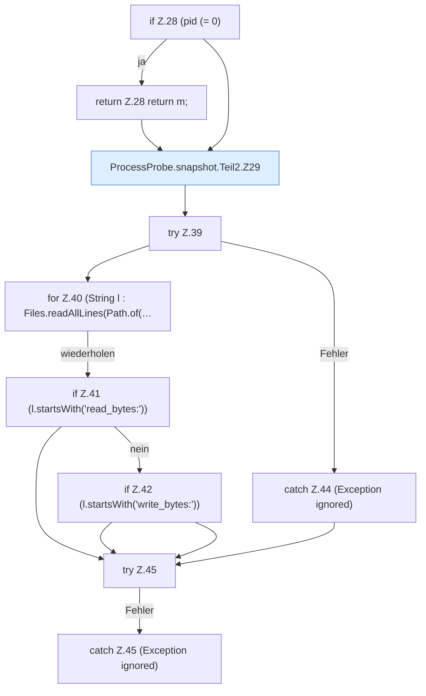

[[00 Start]] › [[Host-Betrieb]] › [[Speicher-Messung]] › [[ProcessProbe]] › [[ProcessProbe.snapshot]] › [[ProcessProbe.snapshot.Teil2]]

# ProcessProbe.snapshot.Teil2



```knoten
if Z.28 (pid (= 0)
  Zeile 28: prüft `(pid (= 0)`.
return Z.28 return m;
  Zeile 28: Rückgabe `return m;`.
ProcessProbe.snapshot.Teil2.Z29
  Fortsetzung des Ablaufs ab Zeile 29.
try Z.39
  Zeile 39: Versuch. Der Fehlerpfad geht in catch.
for Z.40 (String l : Files.readAllLines(Path.of(…
  Zeile 40: Schleife `(String l : Files.readAllLines(Path.of(…`.
if Z.41 (l.startsWith('read_bytes:'))
  Zeile 41: prüft `(l.startsWith('read_bytes:'))`.
if Z.42 (l.startsWith('write_bytes:'))
  Zeile 42: prüft `(l.startsWith('write_bytes:'))`.
catch Z.44 (Exception ignored)
  Zeile 44: fängt (Exception ignored).
try Z.45
  Zeile 45: Versuch. Der Fehlerpfad geht in catch.
catch Z.45 (Exception ignored)
  Zeile 45: fängt (Exception ignored).
```

- Fortsetzung von `ProcessProbe.snapshot`, Quellreihenfolge.
