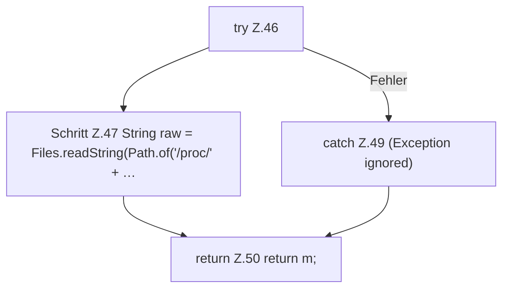

[[00 Start]] › [[Host-Betrieb]] › [[Speicher-Messung]] › [[ProcessProbe]] › [[ProcessProbe.snapshot]] › [[ProcessProbe.snapshot.Teil3]]

# ProcessProbe.snapshot.Teil3



```knoten
try Z.46
  Zeile 46: Versuch. Der Fehlerpfad geht in catch.
Schritt Z.47 String raw = Files.readString(Path.of('/proc/' + …
  Zeile 47: liest Text aus einer Datei. `String raw = Files.readString(Path.of('/proc/' + …`
catch Z.49 (Exception ignored)
  Zeile 49: fängt (Exception ignored).
return Z.50 return m;
  Zeile 50: Rückgabe `return m;`.
```

- Fortsetzung von `ProcessProbe.snapshot`, Quellreihenfolge.
