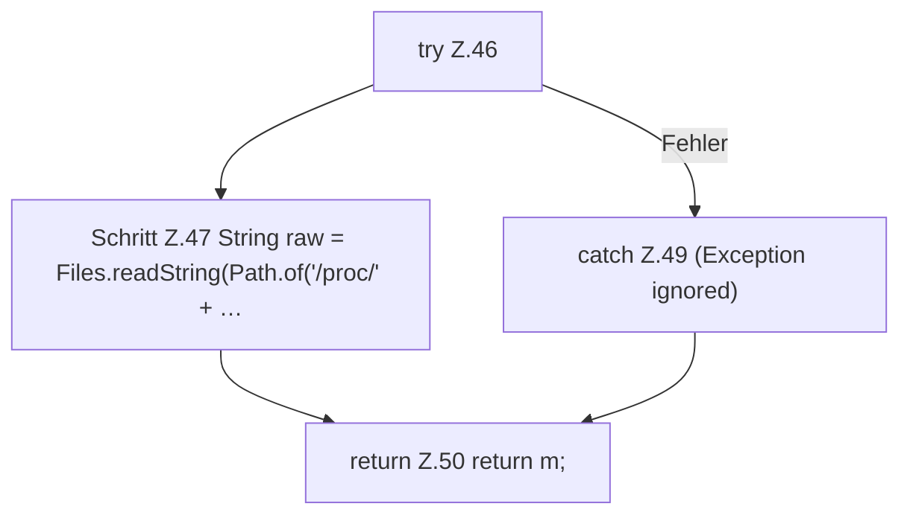

[[00 Start]] › [[Host-Betrieb]] › [[Speicher-Messung]] › [[ProcessProbe]] › [[ProcessProbe.snapshot]] › [[ProcessProbe.snapshot.Teil3]]

# ProcessProbe.snapshot.Teil3

- Fortsetzung von `ProcessProbe.snapshot`, Quellreihenfolge.
