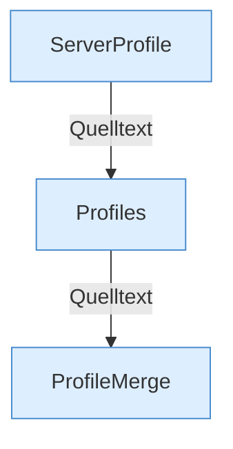

[[00 Start]] › [[Server-Anlage]] › [[Profile]]

# Profile



```knoten
ServerProfile
  Baut ein Profil. type fällt im Code auf fabric zurück, config.yml liefert vanilla.
Profiles
  Lädt servers.*, Fokus und Port-Kollision. Der Kern benutzt davon den ersten Eintrag.
ProfileMerge
  Mischt Properties aus Config und Datei.
```


