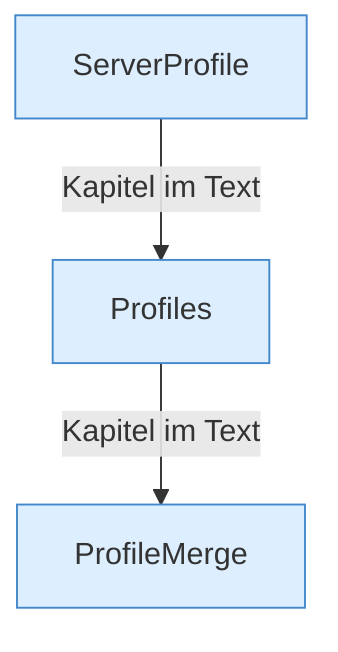

[[00 Start]] › [[Server-Anlage]] › [[Profile]]

# Profile



```knoten
ServerProfile
  Baut diese Beschreibung aus den [[Glossar#Einstellungen|Einstellungen]]. Fehlt die Art des Servers, nimmt der [[Glossar#Quelltext|Quelltext]] fabric an, die ausgelieferte Datei sagt vanilla.
Profiles
  Liest alle Server aus den [[Glossar#Einstellungen|Einstellungen]], inklusive [[Glossar#Fokus|Fokus]] und belegter Türnummern. Der laufende Weg behält davon nur den ersten.
ProfileMerge
  Mischt Werte aus den [[Glossar#Einstellungen|Einstellungen]] und aus einer Datei zu einer Beschreibung zusammen.
```

> [!knoten] Was die Blöcke tun
> - **ServerProfile**: Baut diese Beschreibung aus den [[Glossar#Einstellungen|Einstellungen]]. Fehlt die Art des Servers, nimmt der [[Glossar#Quelltext|Quelltext]] fabric an, die ausgelieferte Datei sagt vanilla.
> - **Profiles**: Liest alle Server aus den [[Glossar#Einstellungen|Einstellungen]], inklusive [[Glossar#Fokus|Fokus]] und belegter Türnummern. Der laufende Weg behält davon nur den ersten.
> - **ProfileMerge**: Mischt Werte aus den [[Glossar#Einstellungen|Einstellungen]] und aus einer Datei zu einer Beschreibung zusammen.

- Die Beschreibung eines Servers: Name, [[Glossar#Version|Version]], Ordner, Speicher.
