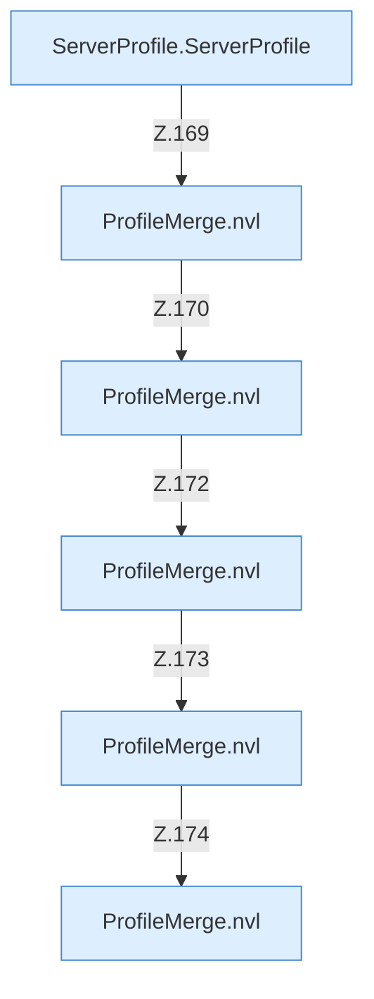

[[00 Start]] › [[Server-Anlage]] › [[Profile]] › [[ProfileMerge]] › [[ProfileMerge.inherit]] › [[ProfileMerge.inherit.Calls7149]]

# ProfileMerge.inherit.Calls7149



```knoten
ServerProfile.ServerProfile
  Die Serverbeschreibung kümmert sich um die Beschreibung. `ServerProfile` in `ServerProfile.java`.
ProfileMerge.nvl
  Dieser Teil macht hier einen einzelnen Schritt. Eine Ebene tiefer steht er genauer. `nvl` in `ServerProfile.java`.
```

> [!knoten]- Was die Blöcke tun
> - **ServerProfile.ServerProfile**: Die Serverbeschreibung kümmert sich um die Beschreibung. `ServerProfile` in `ServerProfile.java`.
> - **ProfileMerge.nvl**: Dieser Teil macht hier einen einzelnen Schritt. Eine Ebene tiefer steht er genauer. `nvl` in `ServerProfile.java`.

- Weitere [[Glossar#Funktion|Funktionen]], die ab [[Glossar#Zeile|Zeile]] 7149 aufgerufen werden.
- Fortsetzung von `ProfileMerge.inherit`.
