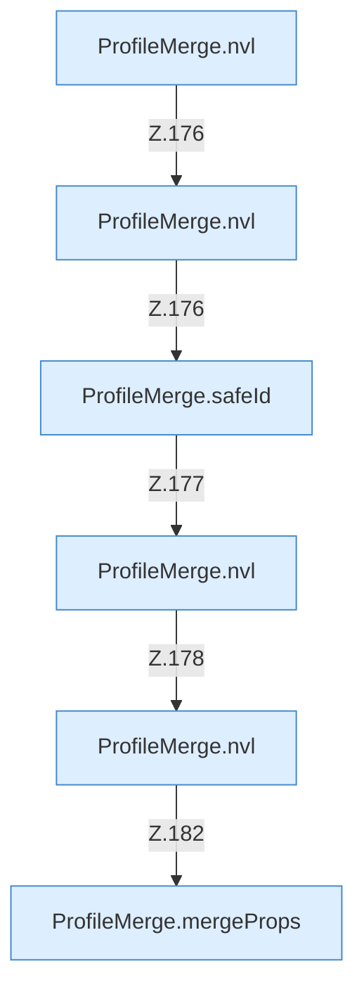

[[00 Start]] › [[Server-Anlage]] › [[Profile]] › [[ProfileMerge]] › [[ProfileMerge.inherit]] › [[ProfileMerge.inherit.Calls7524]]

# ProfileMerge.inherit.Calls7524

- Fortsetzung von `ProfileMerge.inherit`, Quellreihenfolge.
