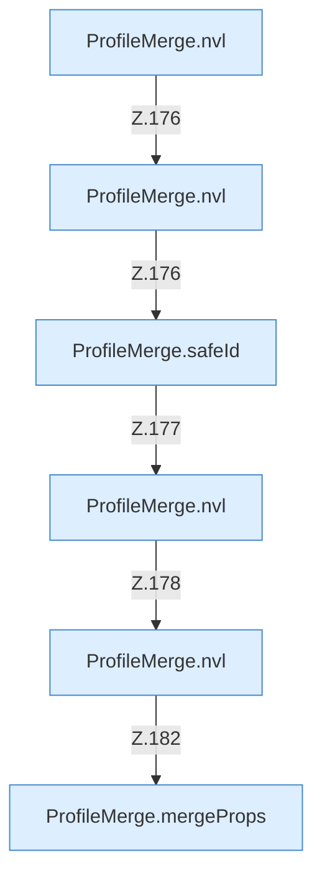

[[00 Start]] › [[Server-Anlage]] › [[Profile]] › [[ProfileMerge]] › [[ProfileMerge.inherit]] › [[ProfileMerge.inherit.Calls7524]]

# ProfileMerge.inherit.Calls7524



```knoten
ProfileMerge.nvl
  Dieser Teil macht hier einen einzelnen Schritt. Eine Ebene tiefer steht er genauer. `nvl` in `ServerProfile.java`.
ProfileMerge.safeId
  Dieser Teil kümmert sich um die Kennung. Prüft die Pfadgrenze `safeId`.
ProfileMerge.mergeProps
  Dieser Teil mischt die Eigenschaften. Mischt `mergeProps`.
```

> [!knoten]- Was die Blöcke tun
> - **ProfileMerge.nvl**: Dieser Teil macht hier einen einzelnen Schritt. Eine Ebene tiefer steht er genauer. `nvl` in `ServerProfile.java`.
> - **ProfileMerge.safeId**: Dieser Teil kümmert sich um die Kennung. Prüft die Pfadgrenze `safeId`.
> - **ProfileMerge.mergeProps**: Dieser Teil mischt die Eigenschaften. Mischt `mergeProps`.

- Weitere [[Glossar#Funktion|Funktionen]], die ab [[Glossar#Zeile|Zeile]] 7524 aufgerufen werden.
- Fortsetzung von `ProfileMerge.inherit`.
