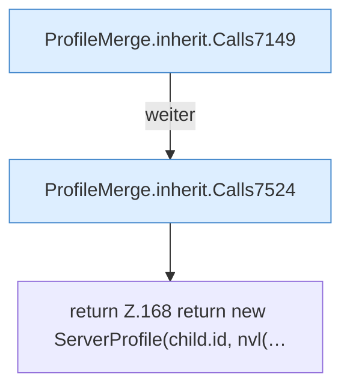

[[00 Start]] › [[Server-Anlage]] › [[Profile]] › [[ProfileMerge]] › [[ProfileMerge.inherit]]

# ProfileMerge.inherit

`ProfileMerge.inherit(ServerProfile child, ServerProfile root)` [src/main/java/de/aichele/childlauncher/ServerProfile.java:167–183](https://github.com/Sciddie/minecraft-serverhoster-plugin/blob/95b02b953b0b4c23673e900e021a7c3c844aa37d/src/main/java/de/aichele/childlauncher/ServerProfile.java#L167-L183)



```knoten
ProfileMerge.inherit.Calls7149
  Weitere [[Glossar#Funktion|Funktionen]], die ab [[Glossar#Zeile|Zeile]] 7149 aufgerufen werden. Weitere eigene Aufrufe ab Zeile 7149.
ProfileMerge.inherit.Calls7524
  Weitere [[Glossar#Funktion|Funktionen]], die ab [[Glossar#Zeile|Zeile]] 7524 aufgerufen werden. Weitere eigene Aufrufe ab Zeile 7524.
return Z.168 return new ServerProfile(child.id, nvl(…
  Zeile 168: Rückgabe `return new ServerProfile(child.id, nvl(…`.
```

> [!knoten]- Was die Blöcke tun
> - **ProfileMerge.inherit.Calls7149**: Weitere [[Glossar#Funktion|Funktionen]], die ab [[Glossar#Zeile|Zeile]] 7149 aufgerufen werden. Weitere eigene Aufrufe ab Zeile 7149.
> - **ProfileMerge.inherit.Calls7524**: Weitere [[Glossar#Funktion|Funktionen]], die ab [[Glossar#Zeile|Zeile]] 7524 aufgerufen werden. Weitere eigene Aufrufe ab Zeile 7524.
> - **return Z.168 return new ServerProfile(child.id, nvl(…**: Zeile 168: Rückgabe `return new ServerProfile(child.id, nvl(…`.

- Dieser Teil macht hier einen einzelnen Schritt. Eine Ebene tiefer steht er genauer.
- `inherit` in `src/main/java/de/aichele/childlauncher/ServerProfile.java`
