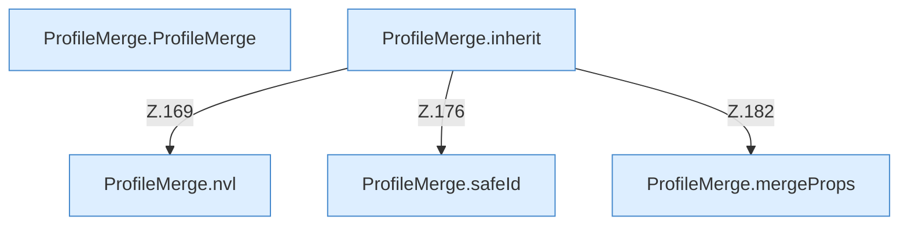

[[00 Start]] › [[Server-Anlage]] › [[Profile]] › [[ProfileMerge]]

# ProfileMerge



```knoten
ProfileMerge.ProfileMerge
  Dieser Teil mischt das. Im [[Glossar#Quelltext|Quelltext]] heißt das `ProfileMerge`.
ProfileMerge.inherit
  Dieser Teil macht hier einen einzelnen Schritt. Eine Ebene tiefer steht er genauer. Im [[Glossar#Quelltext|Quelltext]] heißt das `inherit`.
ProfileMerge.mergeProps
  Dieser Teil mischt die Eigenschaften. Im [[Glossar#Quelltext|Quelltext]] heißt das `mergeProps`.
ProfileMerge.nvl
  Dieser Teil macht hier einen einzelnen Schritt. Eine Ebene tiefer steht er genauer. Im [[Glossar#Quelltext|Quelltext]] heißt das `nvl`.
ProfileMerge.safeId
  Dieser Teil kümmert sich um die Kennung. Im [[Glossar#Quelltext|Quelltext]] heißt das `safeId`.
```

> [!knoten]- Was die Blöcke tun
> - **ProfileMerge.ProfileMerge**: Dieser Teil mischt das. Im [[Glossar#Quelltext|Quelltext]] heißt das `ProfileMerge`.
> - **ProfileMerge.inherit**: Dieser Teil macht hier einen einzelnen Schritt. Eine Ebene tiefer steht er genauer. Im [[Glossar#Quelltext|Quelltext]] heißt das `inherit`.
> - **ProfileMerge.mergeProps**: Dieser Teil mischt die Eigenschaften. Im [[Glossar#Quelltext|Quelltext]] heißt das `mergeProps`.
> - **ProfileMerge.nvl**: Dieser Teil macht hier einen einzelnen Schritt. Eine Ebene tiefer steht er genauer. Im [[Glossar#Quelltext|Quelltext]] heißt das `nvl`.
> - **ProfileMerge.safeId**: Dieser Teil kümmert sich um die Kennung. Im [[Glossar#Quelltext|Quelltext]] heißt das `safeId`.

- Mischt Werte aus den [[Glossar#Einstellungen|Einstellungen]] und aus einer Datei zu einer Beschreibung zusammen.
