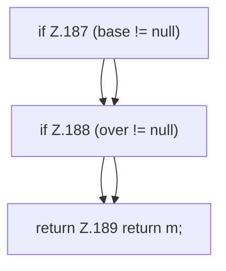

[[00 Start]] › [[Server-Anlage]] › [[Profile]] › [[ProfileMerge]] › [[ProfileMerge.mergeProps]]

# ProfileMerge.mergeProps

`ProfileMerge.mergeProps(Map<String, String> base, Map<String, String> over)` [src/main/java/de/aichele/childlauncher/ServerProfile.java:185–190](https://github.com/Sciddie/minecraft-serverhoster-plugin/blob/95b02b953b0b4c23673e900e021a7c3c844aa37d/src/main/java/de/aichele/childlauncher/ServerProfile.java#L185-L190)



```knoten
if Z.187 (base != null)
  Zeile 187: prüft `(base != null)`.
if Z.188 (over != null)
  Zeile 188: prüft `(over != null)`.
return Z.189 return m;
  Zeile 189: Rückgabe `return m;`.
```

> [!knoten]- Was die Blöcke tun
> - **if Z.187 (base != null)**: Zeile 187: prüft `(base != null)`.
> - **if Z.188 (over != null)**: Zeile 188: prüft `(over != null)`.
> - **return Z.189 return m;**: Zeile 189: Rückgabe `return m;`.

- Dieser Teil mischt die Eigenschaften.
- `mergeProps` in `src/main/java/de/aichele/childlauncher/ServerProfile.java`
