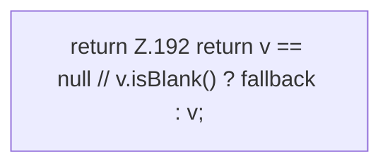

[[00 Start]] › [[Server-Anlage]] › [[Profile]] › [[ProfileMerge]] › [[ProfileMerge.nvl]]

# ProfileMerge.nvl

`ProfileMerge.nvl(String v, String fallback)` [src/main/java/de/aichele/childlauncher/ServerProfile.java:192–192](https://github.com/Sciddie/minecraft-serverhoster-plugin/blob/95b02b953b0b4c23673e900e021a7c3c844aa37d/src/main/java/de/aichele/childlauncher/ServerProfile.java#L192-L192)



```knoten
return Z.192 return v == null // v.isBlank() ? fallback : v;
  Zeile 192: Rückgabe `return v == null // v.isBlank() ? fallback : v;`.
```

> [!knoten]- Was die Blöcke tun
> - **return Z.192 return v == null // v.isBlank() ? fallback : v;**: Zeile 192: Rückgabe `return v == null // v.isBlank() ? fallback : v;`.

- Dieser Teil macht hier einen einzelnen Schritt. Eine Ebene tiefer steht er genauer.
- `nvl` in `src/main/java/de/aichele/childlauncher/ServerProfile.java`
