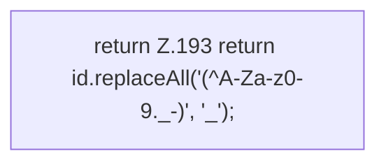

[[00 Start]] › [[Server-Anlage]] › [[Profile]] › [[ProfileMerge]] › [[ProfileMerge.safeId]]

# ProfileMerge.safeId

`ProfileMerge.safeId(String id)` [src/main/java/de/aichele/childlauncher/ServerProfile.java:193–193](https://github.com/Sciddie/minecraft-serverhoster-plugin/blob/95b02b953b0b4c23673e900e021a7c3c844aa37d/src/main/java/de/aichele/childlauncher/ServerProfile.java#L193-L193)



```knoten
return Z.193 return id.replaceAll('(^A-Za-z0-9._-)', '_');
  Zeile 193: Rückgabe `return id.replaceAll('(^A-Za-z0-9._-)', '_');`.
```

> [!knoten]- Was die Blöcke tun
> - **return Z.193 return id.replaceAll('(^A-Za-z0-9._-)', '_');**: Zeile 193: Rückgabe `return id.replaceAll('(^A-Za-z0-9._-)', '_');`.

- Dieser Teil kümmert sich um die Kennung.
- `safeId` in `src/main/java/de/aichele/childlauncher/ServerProfile.java`
