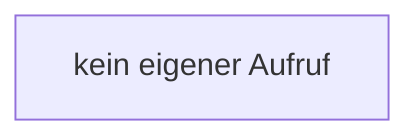

[[00 Start]] › [[Server-Anlage]] › [[Profile]] › [[Profiles]] › [[Profiles.Profiles]]

# Profiles.Profiles

`Profiles.Profiles()` [src/main/java/de/aichele/childlauncher/ServerProfile.java:64–64](https://github.com/Sciddie/minecraft-serverhoster-plugin/blob/95b02b953b0b4c23673e900e021a7c3c844aa37d/src/main/java/de/aichele/childlauncher/ServerProfile.java#L64-L64)



```knoten
kein eigener Aufruf
  In diesem Stück gibt es keinen weiteren eigenen Aufruf.
```

- `Profiles` in `src/main/java/de/aichele/childlauncher/ServerProfile.java`
