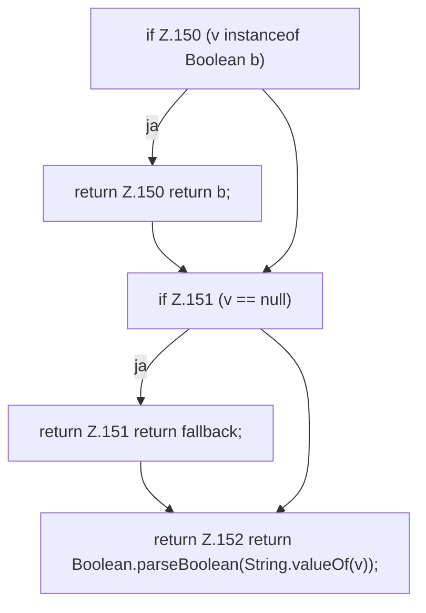

[[00 Start]] › [[Server-Anlage]] › [[Profile]] › [[Profiles]] › [[Profiles.bool]]

# Profiles.bool

`Profiles.bool(Map<String, Object> flat, String key, boolean fallback)` [src/main/java/de/aichele/childlauncher/ServerProfile.java:148–153](https://github.com/Sciddie/minecraft-serverhoster-plugin/blob/95b02b953b0b4c23673e900e021a7c3c844aa37d/src/main/java/de/aichele/childlauncher/ServerProfile.java#L148-L153)



```knoten
if Z.150 (v instanceof Boolean b)
  Zeile 150: prüft `(v instanceof Boolean b)`.
return Z.150 return b;
  Zeile 150: Rückgabe `return b;`.
if Z.151 (v == null)
  Zeile 151: prüft `(v == null)`.
return Z.151 return fallback;
  Zeile 151: Rückgabe `return fallback;`.
return Z.152 return Boolean.parseBoolean(String.valueOf(v));
  Zeile 152: Rückgabe `return Boolean.parseBoolean(String.valueOf(v));`.
```

> [!knoten]- Was die Blöcke tun
> - **if Z.150 (v instanceof Boolean b)**: Zeile 150: prüft `(v instanceof Boolean b)`.
> - **return Z.150 return b;**: Zeile 150: Rückgabe `return b;`.
> - **if Z.151 (v == null)**: Zeile 151: prüft `(v == null)`.
> - **return Z.151 return fallback;**: Zeile 151: Rückgabe `return fallback;`.
> - **return Z.152 return Boolean.parseBoolean(String.valueOf(v));**: Zeile 152: Rückgabe `return Boolean.parseBoolean(String.valueOf(v));`.

- Die Serverbeschreibung macht hier einen einzelnen Schritt. Eine Ebene tiefer steht er genauer.
- `bool` in `src/main/java/de/aichele/childlauncher/ServerProfile.java`
