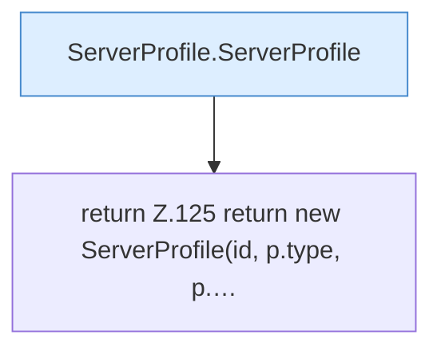

[[00 Start]] › [[Server-Anlage]] › [[Profile]] › [[Profiles]] › [[Profiles.copyId]]

# Profiles.copyId

`Profiles.copyId(ServerProfile p, String id)` [src/main/java/de/aichele/childlauncher/ServerProfile.java:124–127](https://github.com/Sciddie/minecraft-serverhoster-plugin/blob/95b02b953b0b4c23673e900e021a7c3c844aa37d/src/main/java/de/aichele/childlauncher/ServerProfile.java#L124-L127)

- `copyId` in `src/main/java/de/aichele/childlauncher/ServerProfile.java`
