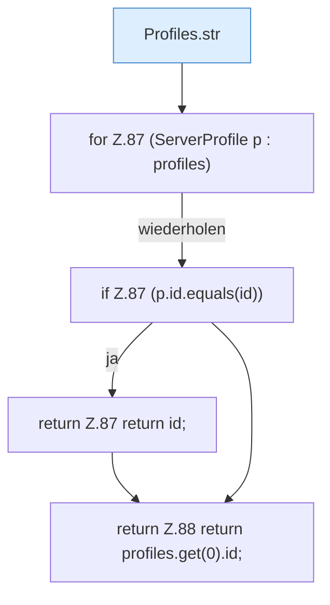

[[00 Start]] › [[Server-Anlage]] › [[Profile]] › [[Profiles]] › [[Profiles.focus]]

# Profiles.focus

`Profiles.focus(Map<String, Object> flat, List<ServerProfile> profiles)` [src/main/java/de/aichele/childlauncher/ServerProfile.java:85–89](https://github.com/Sciddie/minecraft-serverhoster-plugin/blob/95b02b953b0b4c23673e900e021a7c3c844aa37d/src/main/java/de/aichele/childlauncher/ServerProfile.java#L85-L89)



```knoten
Profiles.str
  Die Serverbeschreibung macht hier einen einzelnen Schritt. Eine Ebene tiefer steht er genauer. `str` in `ServerProfile.java`.
for Z.87 (ServerProfile p : profiles)
  Zeile 87: Schleife `(ServerProfile p : profiles)`.
if Z.87 (p.id.equals(id))
  Zeile 87: prüft `(p.id.equals(id))`.
return Z.87 return id;
  Zeile 87: Rückgabe `return id;`.
return Z.88 return profiles.get(0).id;
  Zeile 88: Rückgabe `return profiles.get(0).id;`.
```

> [!knoten]- Was die Blöcke tun
> - **Profiles.str**: Die Serverbeschreibung macht hier einen einzelnen Schritt. Eine Ebene tiefer steht er genauer. `str` in `ServerProfile.java`.
> - **for Z.87 (ServerProfile p : profiles)**: Zeile 87: Schleife `(ServerProfile p : profiles)`.
> - **if Z.87 (p.id.equals(id))**: Zeile 87: prüft `(p.id.equals(id))`.
> - **return Z.87 return id;**: Zeile 87: Rückgabe `return id;`.
> - **return Z.88 return profiles.get(0).id;**: Zeile 88: Rückgabe `return profiles.get(0).id;`.

- Würde den gemeinten Server aus den [[Glossar#Einstellungen|Einstellungen]] lesen. Der laufende Weg benutzt das nicht.
- Wird vom Plugin-Kern nicht für die laufende Auswahl benutzt.
- Befund: angemeldet aber nicht umgesetzt, wahrscheinlich. ServerProfile.java:85, nur Tests rufen Profiles.focus
