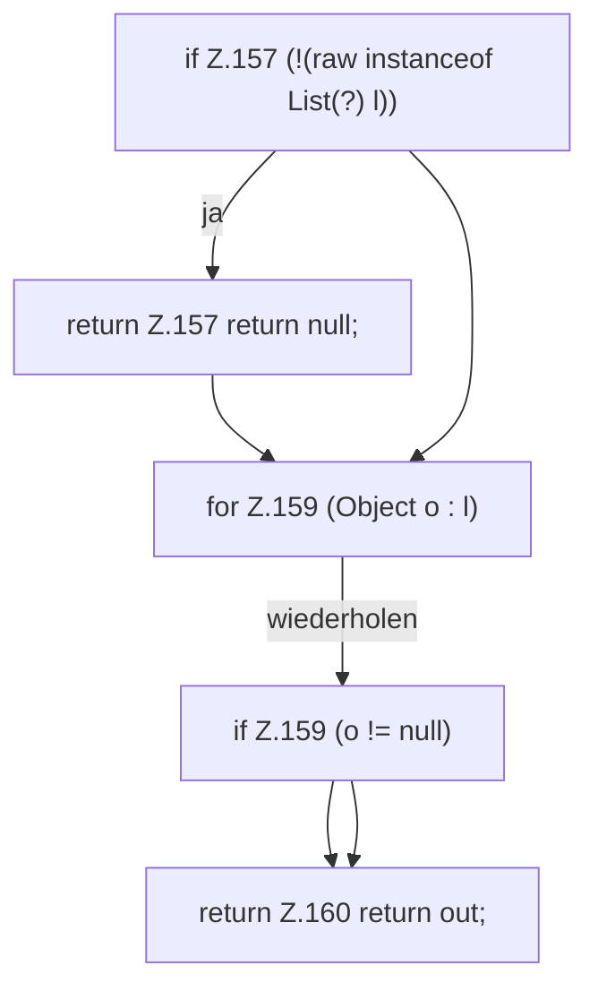

[[00 Start]] › [[Server-Anlage]] › [[Profile]] › [[Profiles]] › [[Profiles.list]]

# Profiles.list

`Profiles.list(Object raw)` [src/main/java/de/aichele/childlauncher/ServerProfile.java:155–161](https://github.com/Sciddie/minecraft-serverhoster-plugin/blob/95b02b953b0b4c23673e900e021a7c3c844aa37d/src/main/java/de/aichele/childlauncher/ServerProfile.java#L155-L161)



```knoten
if Z.157 (!(raw instanceof List(?) l))
  Zeile 157: prüft `(!(raw instanceof List(?) l))`.
return Z.157 return null;
  Zeile 157: Rückgabe `return null;`.
for Z.159 (Object o : l)
  Zeile 159: Schleife `(Object o : l)`.
if Z.159 (o != null)
  Zeile 159: prüft `(o != null)`.
return Z.160 return out;
  Zeile 160: Rückgabe `return out;`.
```

> [!knoten]- Was die Blöcke tun
> - **if Z.157 (!(raw instanceof List(?) l))**: Zeile 157: prüft `(!(raw instanceof List(?) l))`.
> - **return Z.157 return null;**: Zeile 157: Rückgabe `return null;`.
> - **for Z.159 (Object o : l)**: Zeile 159: Schleife `(Object o : l)`.
> - **if Z.159 (o != null)**: Zeile 159: prüft `(o != null)`.
> - **return Z.160 return out;**: Zeile 160: Rückgabe `return out;`.

- Die Serverbeschreibung zeigt das.
- `list` in `src/main/java/de/aichele/childlauncher/ServerProfile.java`
