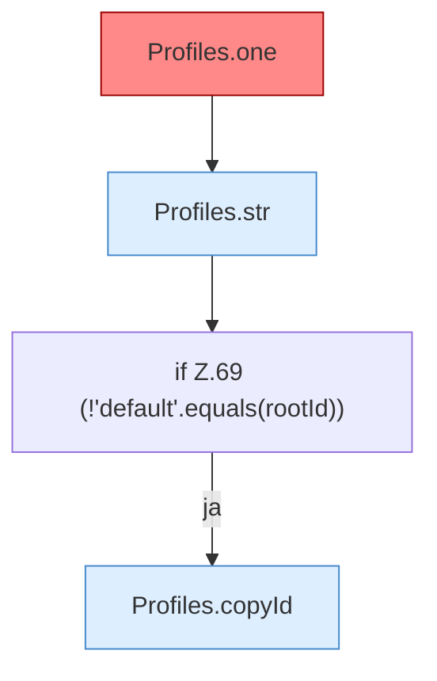

[[00 Start]] › [[Server-Anlage]] › [[Profile]] › [[Profiles]] › [[Profiles.load]] › [[Profiles.load.Teil1]]

# Profiles.load.Teil1



```knoten
Profiles.one
  Baut die Beschreibung eines Servers. Fehlt die Art, nimmt der [[Glossar#Quelltext|Quelltext]] fabric, die ausgelieferte [[Glossar#Einstellungsdatei|Einstellungsdatei]] sagt vanilla. Fallback `type` ist `fabric`, ausgelieferte `config.yml` sagt `vanilla`. [[Glossar#Befund|Befund]]: Logikrisiko, sicher. ServerProfile.java:103 Fallback fabric, config.yml:2 type vanilla
Profiles.str
  Die Serverbeschreibung macht hier einen einzelnen Schritt. Eine Ebene tiefer steht er genauer. `str` in `ServerProfile.java`.
if Z.69 (!'default'.equals(rootId))
  Zeile 69: prüft `(!'default'.equals(rootId))`.
Profiles.copyId
  Die Serverbeschreibung kopiert die Kennung. Kopiert `copyId`. Ruft `ServerProfile`.
```

> [!knoten]- Was die Blöcke tun
> - **Profiles.one**: Baut die Beschreibung eines Servers. Fehlt die Art, nimmt der [[Glossar#Quelltext|Quelltext]] fabric, die ausgelieferte [[Glossar#Einstellungsdatei|Einstellungsdatei]] sagt vanilla. Fallback `type` ist `fabric`, ausgelieferte `config.yml` sagt `vanilla`. [[Glossar#Befund|Befund]]: Logikrisiko, sicher. ServerProfile.java:103 Fallback fabric, config.yml:2 type vanilla
> - **Profiles.str**: Die Serverbeschreibung macht hier einen einzelnen Schritt. Eine Ebene tiefer steht er genauer. `str` in `ServerProfile.java`.
> - **if Z.69 (!'default'.equals(rootId))**: Zeile 69: prüft `(!'default'.equals(rootId))`.
> - **Profiles.copyId**: Die Serverbeschreibung kopiert die Kennung. Kopiert `copyId`. Ruft `ServerProfile`.

- Ein weiterer Abschnitt derselben Übersicht.
- Fortsetzung von `Profiles.load`.
