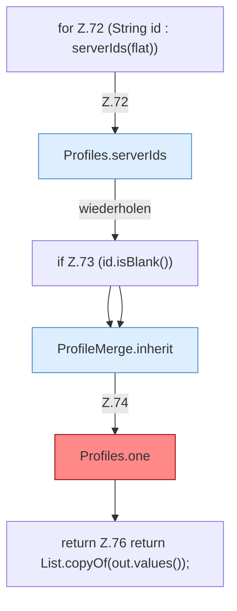

[[00 Start]] › [[Server-Anlage]] › [[Profile]] › [[Profiles]] › [[Profiles.load]] › [[Profiles.load.Teil2]]

# Profiles.load.Teil2



```knoten
for Z.72 (String id : serverIds(flat))
  Zeile 72: Schleife `(String id : serverIds(flat))`.
Profiles.serverIds
  `serverIds` in `ServerProfile.java`.
if Z.73 (id.isBlank())
  Zeile 73: prüft `(id.isBlank())`.
ProfileMerge.inherit
  `inherit` in `ServerProfile.java`. Ruft `ServerProfile`, `nvl`, `safeId`.
Profiles.one
  Fallback `type` ist `fabric`, ausgelieferte `config.yml` sagt `vanilla`. Befund: Logikrisiko (sicher).
return Z.76 return List.copyOf(out.values());
  Zeile 76: Rückgabe `return List.copyOf(out.values());`.
```

- Fortsetzung von `Profiles.load`, Quellreihenfolge.
