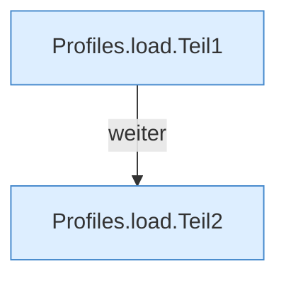

[[00 Start]] › [[Server-Anlage]] › [[Profile]] › [[Profiles]] › [[Profiles.load]]

# Profiles.load

`Profiles.load(Map<String, Object> flat)` [src/main/java/de/aichele/childlauncher/ServerProfile.java:66–77](https://github.com/Sciddie/minecraft-serverhoster-plugin/blob/95b02b953b0b4c23673e900e021a7c3c844aa37d/src/main/java/de/aichele/childlauncher/ServerProfile.java#L66-L77)



```knoten
Profiles.load.Teil1
  Abschnitt 1 dieses Ablaufs, in Quellreihenfolge.
Profiles.load.Teil2
  Abschnitt 2 dieses Ablaufs, in Quellreihenfolge.
```

- `load` in `src/main/java/de/aichele/childlauncher/ServerProfile.java`
- Befund: angemeldet aber nicht umgesetzt, sicher. ServerProfile.java Profiles.load liest servers.*, reloadProfiles nutzt nur den ersten
