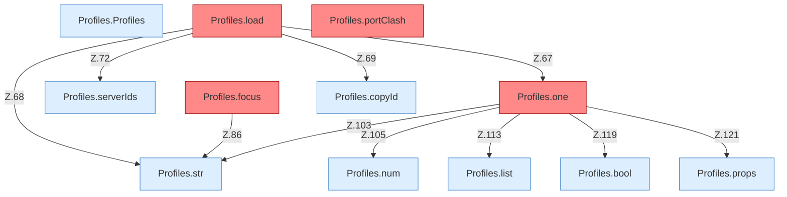

[[00 Start]] › [[Server-Anlage]] › [[Profile]] › [[Profiles]]

# Profiles



```knoten
Profiles.Profiles
  Die Serverbeschreibung macht hier einen einzelnen Schritt. Eine Ebene tiefer steht er genauer. Im [[Glossar#Quelltext|Quelltext]] heißt das `Profiles`.
Profiles.load
  Die Serverbeschreibung lädt das. Im [[Glossar#Quelltext|Quelltext]] heißt das `load`. Auffällig: es ist vorgesehen, der laufende Weg benutzt es aber nicht. Das nennt man [[Glossar#Nicht benutzt|Nicht benutzt]].
Profiles.portClash
  Würde merken, wenn zwei Server dieselbe Türnummer hätten. Der laufende Weg benutzt das nicht. Im [[Glossar#Quelltext|Quelltext]] heißt das `portClash`. Auffällig: es ist vorgesehen, der laufende Weg benutzt es aber nicht. Das nennt man [[Glossar#Nicht benutzt|Nicht benutzt]].
Profiles.focus
  Würde den gemeinten Server aus den [[Glossar#Einstellungen|Einstellungen]] lesen. Der laufende Weg benutzt das nicht. Im [[Glossar#Quelltext|Quelltext]] heißt das `focus`. Auffällig: es ist vorgesehen, der laufende Weg benutzt es aber nicht. Das nennt man [[Glossar#Nicht benutzt|Nicht benutzt]].
Profiles.serverIds
  Die Serverbeschreibung macht hier einen einzelnen Schritt. Eine Ebene tiefer steht er genauer. Im [[Glossar#Quelltext|Quelltext]] heißt das `serverIds`.
Profiles.one
  Baut die Beschreibung eines Servers. Fehlt die Art, nimmt der [[Glossar#Quelltext|Quelltext]] fabric, die ausgelieferte [[Glossar#Einstellungsdatei|Einstellungsdatei]] sagt vanilla. Im Quelltext heißt das `one`. Auffällig: das kann sich anders verhalten, als man erwartet. Das nennt man [[Glossar#Unerwartetes Verhalten|Unerwartetes Verhalten]].
Profiles.copyId
  Die Serverbeschreibung kopiert die Kennung. Im [[Glossar#Quelltext|Quelltext]] heißt das `copyId`.
Profiles.props
  Die Serverbeschreibung macht hier einen einzelnen Schritt. Eine Ebene tiefer steht er genauer. Im [[Glossar#Quelltext|Quelltext]] heißt das `props`.
Profiles.str
  Die Serverbeschreibung macht hier einen einzelnen Schritt. Eine Ebene tiefer steht er genauer. Im [[Glossar#Quelltext|Quelltext]] heißt das `str`.
Profiles.num
  Die Serverbeschreibung macht hier einen einzelnen Schritt. Eine Ebene tiefer steht er genauer. Im [[Glossar#Quelltext|Quelltext]] heißt das `num`.
Profiles.bool
  Die Serverbeschreibung macht hier einen einzelnen Schritt. Eine Ebene tiefer steht er genauer. Im [[Glossar#Quelltext|Quelltext]] heißt das `bool`.
Profiles.list
  Die Serverbeschreibung zeigt das. Im [[Glossar#Quelltext|Quelltext]] heißt das `list`.
```

> [!knoten]- Was die Blöcke tun
> - **Profiles.Profiles**: Die Serverbeschreibung macht hier einen einzelnen Schritt. Eine Ebene tiefer steht er genauer. Im [[Glossar#Quelltext|Quelltext]] heißt das `Profiles`.
> - **Profiles.load**: Die Serverbeschreibung lädt das. Im [[Glossar#Quelltext|Quelltext]] heißt das `load`. Auffällig: es ist vorgesehen, der laufende Weg benutzt es aber nicht. Das nennt man [[Glossar#Nicht benutzt|Nicht benutzt]].
> - **Profiles.portClash**: Würde merken, wenn zwei Server dieselbe Türnummer hätten. Der laufende Weg benutzt das nicht. Im [[Glossar#Quelltext|Quelltext]] heißt das `portClash`. Auffällig: es ist vorgesehen, der laufende Weg benutzt es aber nicht. Das nennt man [[Glossar#Nicht benutzt|Nicht benutzt]].
> - **Profiles.focus**: Würde den gemeinten Server aus den [[Glossar#Einstellungen|Einstellungen]] lesen. Der laufende Weg benutzt das nicht. Im [[Glossar#Quelltext|Quelltext]] heißt das `focus`. Auffällig: es ist vorgesehen, der laufende Weg benutzt es aber nicht. Das nennt man [[Glossar#Nicht benutzt|Nicht benutzt]].
> - **Profiles.serverIds**: Die Serverbeschreibung macht hier einen einzelnen Schritt. Eine Ebene tiefer steht er genauer. Im [[Glossar#Quelltext|Quelltext]] heißt das `serverIds`.
> - **Profiles.one**: Baut die Beschreibung eines Servers. Fehlt die Art, nimmt der [[Glossar#Quelltext|Quelltext]] fabric, die ausgelieferte [[Glossar#Einstellungsdatei|Einstellungsdatei]] sagt vanilla. Im Quelltext heißt das `one`. Auffällig: das kann sich anders verhalten, als man erwartet. Das nennt man [[Glossar#Unerwartetes Verhalten|Unerwartetes Verhalten]].
> - **Profiles.copyId**: Die Serverbeschreibung kopiert die Kennung. Im [[Glossar#Quelltext|Quelltext]] heißt das `copyId`.
> - **Profiles.props**: Die Serverbeschreibung macht hier einen einzelnen Schritt. Eine Ebene tiefer steht er genauer. Im [[Glossar#Quelltext|Quelltext]] heißt das `props`.
> - **Profiles.str**: Die Serverbeschreibung macht hier einen einzelnen Schritt. Eine Ebene tiefer steht er genauer. Im [[Glossar#Quelltext|Quelltext]] heißt das `str`.
> - **Profiles.num**: Die Serverbeschreibung macht hier einen einzelnen Schritt. Eine Ebene tiefer steht er genauer. Im [[Glossar#Quelltext|Quelltext]] heißt das `num`.
> - **Profiles.bool**: Die Serverbeschreibung macht hier einen einzelnen Schritt. Eine Ebene tiefer steht er genauer. Im [[Glossar#Quelltext|Quelltext]] heißt das `bool`.
> - **Profiles.list**: Die Serverbeschreibung zeigt das. Im [[Glossar#Quelltext|Quelltext]] heißt das `list`.

- Liest alle Server aus den [[Glossar#Einstellungen|Einstellungen]], inklusive [[Glossar#Fokus|Fokus]] und belegter Türnummern. Der laufende Weg behält davon nur den ersten.
