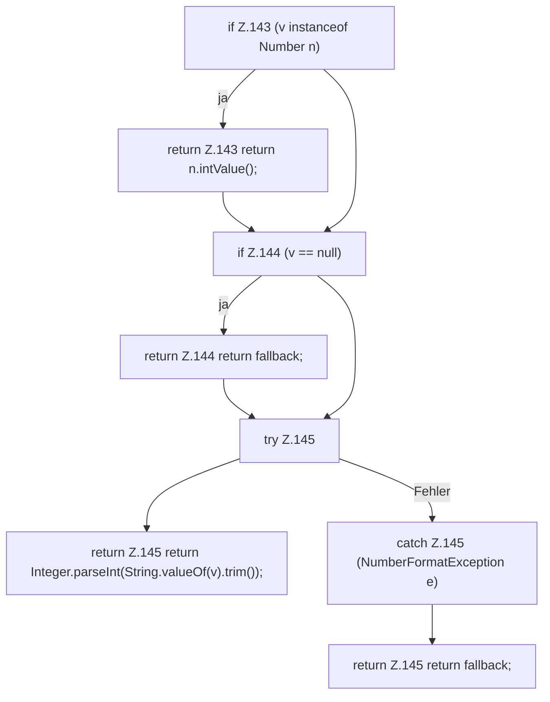

[[00 Start]] › [[Server-Anlage]] › [[Profile]] › [[Profiles]] › [[Profiles.num]]

# Profiles.num

`Profiles.num(Map<String, Object> flat, String key, int fallback)` [src/main/java/de/aichele/childlauncher/ServerProfile.java:141–146](https://github.com/Sciddie/minecraft-serverhoster-plugin/blob/95b02b953b0b4c23673e900e021a7c3c844aa37d/src/main/java/de/aichele/childlauncher/ServerProfile.java#L141-L146)

- `num` in `src/main/java/de/aichele/childlauncher/ServerProfile.java`
