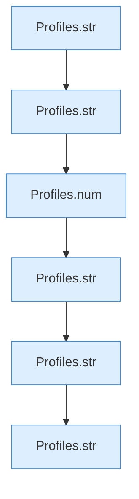

[[00 Start]] › [[Server-Anlage]] › [[Profile]] › [[Profiles]] › [[Profiles.one]] › [[Profiles.one.Teil1]]

# Profiles.one.Teil1



```knoten
Profiles.str
  Die Serverbeschreibung macht hier einen einzelnen Schritt. Eine Ebene tiefer steht er genauer. `str` in `ServerProfile.java`.
Profiles.num
  Die Serverbeschreibung macht hier einen einzelnen Schritt. Eine Ebene tiefer steht er genauer. `num` in `ServerProfile.java`.
```

> [!knoten]- Was die Blöcke tun
> - **Profiles.str**: Die Serverbeschreibung macht hier einen einzelnen Schritt. Eine Ebene tiefer steht er genauer. `str` in `ServerProfile.java`.
> - **Profiles.num**: Die Serverbeschreibung macht hier einen einzelnen Schritt. Eine Ebene tiefer steht er genauer. `num` in `ServerProfile.java`.

- Ein weiterer Abschnitt derselben Übersicht.
- Fortsetzung von `Profiles.one`.
