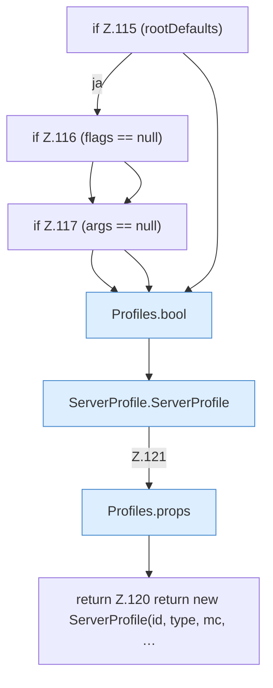

[[00 Start]] › [[Server-Anlage]] › [[Profile]] › [[Profiles]] › [[Profiles.one]] › [[Profiles.one.Teil3]]

# Profiles.one.Teil3



```knoten
if Z.115 (rootDefaults)
  Zeile 115: prüft `(rootDefaults)`.
if Z.116 (flags == null)
  Zeile 116: prüft `(flags == null)`.
if Z.117 (args == null)
  Zeile 117: prüft `(args == null)`.
Profiles.bool
  Die Serverbeschreibung macht hier einen einzelnen Schritt. Eine Ebene tiefer steht er genauer. `bool` in `ServerProfile.java`.
ServerProfile.ServerProfile
  Die Serverbeschreibung kümmert sich um die Beschreibung. `ServerProfile` in `ServerProfile.java`.
Profiles.props
  Die Serverbeschreibung macht hier einen einzelnen Schritt. Eine Ebene tiefer steht er genauer. `props` in `ServerProfile.java`.
return Z.120 return new ServerProfile(id, type, mc, …
  Zeile 120: Rückgabe `return new ServerProfile(id, type, mc, …`.
```

> [!knoten]- Was die Blöcke tun
> - **if Z.115 (rootDefaults)**: Zeile 115: prüft `(rootDefaults)`.
> - **if Z.116 (flags == null)**: Zeile 116: prüft `(flags == null)`.
> - **if Z.117 (args == null)**: Zeile 117: prüft `(args == null)`.
> - **Profiles.bool**: Die Serverbeschreibung macht hier einen einzelnen Schritt. Eine Ebene tiefer steht er genauer. `bool` in `ServerProfile.java`.
> - **ServerProfile.ServerProfile**: Die Serverbeschreibung kümmert sich um die Beschreibung. `ServerProfile` in `ServerProfile.java`.
> - **Profiles.props**: Die Serverbeschreibung macht hier einen einzelnen Schritt. Eine Ebene tiefer steht er genauer. `props` in `ServerProfile.java`.
> - **return Z.120 return new ServerProfile(id, type, mc, …**: Zeile 120: Rückgabe `return new ServerProfile(id, type, mc, …`.

- Ein weiterer Abschnitt derselben Übersicht.
- Fortsetzung von `Profiles.one`.
