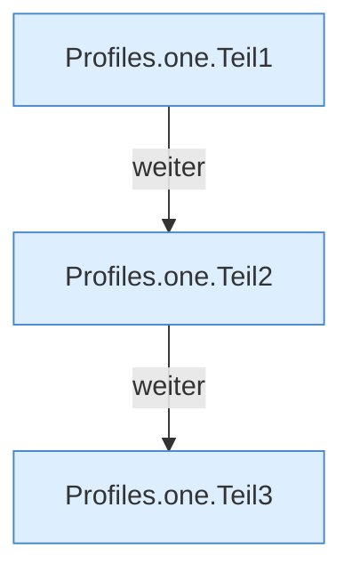

[[00 Start]] › [[Server-Anlage]] › [[Profile]] › [[Profiles]] › [[Profiles.one]]

# Profiles.one

`Profiles.one(Map<String, Object> flat, String id, String prefix, boolean rootDefaults)` [src/main/java/de/aichele/childlauncher/ServerProfile.java:102–122](https://github.com/Sciddie/minecraft-serverhoster-plugin/blob/95b02b953b0b4c23673e900e021a7c3c844aa37d/src/main/java/de/aichele/childlauncher/ServerProfile.java#L102-L122)



```knoten
Profiles.one.Teil1
  Abschnitt 1 dieses Ablaufs, in Quellreihenfolge.
Profiles.one.Teil2
  Abschnitt 2 dieses Ablaufs, in Quellreihenfolge.
Profiles.one.Teil3
  Abschnitt 3 dieses Ablaufs, in Quellreihenfolge.
```

- Fallback `type` ist `fabric`, ausgelieferte `config.yml` sagt `vanilla`.
- Befund: Logikrisiko, sicher. ServerProfile.java:103 Fallback fabric, config.yml:2 type vanilla
