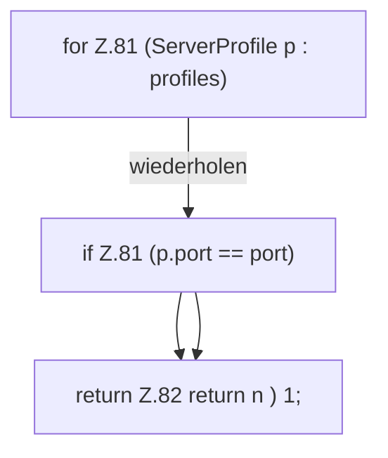

[[00 Start]] › [[Server-Anlage]] › [[Profile]] › [[Profiles]] › [[Profiles.portClash]]

# Profiles.portClash

`Profiles.portClash(List<ServerProfile> profiles, int port)` [src/main/java/de/aichele/childlauncher/ServerProfile.java:79–83](https://github.com/Sciddie/minecraft-serverhoster-plugin/blob/95b02b953b0b4c23673e900e021a7c3c844aa37d/src/main/java/de/aichele/childlauncher/ServerProfile.java#L79-L83)

- Wird vom Plugin-Kern nicht ausgewertet.
- Befund: angemeldet aber nicht umgesetzt, wahrscheinlich. ServerProfile.java:79, nur Tests rufen Profiles.portClash
