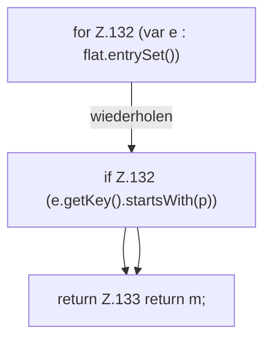

[[00 Start]] › [[Server-Anlage]] › [[Profile]] › [[Profiles]] › [[Profiles.props]]

# Profiles.props

`Profiles.props(Map<String, Object> flat, String prefix)` [src/main/java/de/aichele/childlauncher/ServerProfile.java:129–134](https://github.com/Sciddie/minecraft-serverhoster-plugin/blob/95b02b953b0b4c23673e900e021a7c3c844aa37d/src/main/java/de/aichele/childlauncher/ServerProfile.java#L129-L134)



```knoten
for Z.132 (var e : flat.entrySet())
  Zeile 132: Schleife `(var e : flat.entrySet())`.
if Z.132 (e.getKey().startsWith(p))
  Zeile 132: prüft `(e.getKey().startsWith(p))`.
return Z.133 return m;
  Zeile 133: Rückgabe `return m;`.
```

- `props` in `src/main/java/de/aichele/childlauncher/ServerProfile.java`
