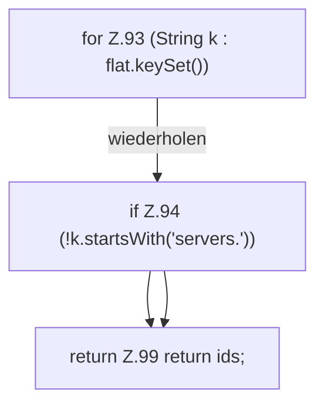

[[00 Start]] › [[Server-Anlage]] › [[Profile]] › [[Profiles]] › [[Profiles.serverIds]]

# Profiles.serverIds

`Profiles.serverIds(Map<String, Object> flat)` [src/main/java/de/aichele/childlauncher/ServerProfile.java:91–100](https://github.com/Sciddie/minecraft-serverhoster-plugin/blob/95b02b953b0b4c23673e900e021a7c3c844aa37d/src/main/java/de/aichele/childlauncher/ServerProfile.java#L91-L100)



```knoten
for Z.93 (String k : flat.keySet())
  Zeile 93: Schleife `(String k : flat.keySet())`.
if Z.94 (!k.startsWith('servers.'))
  Zeile 94: prüft `(!k.startsWith('servers.'))`.
return Z.99 return ids;
  Zeile 99: Rückgabe `return ids;`.
```

- `serverIds` in `src/main/java/de/aichele/childlauncher/ServerProfile.java`
