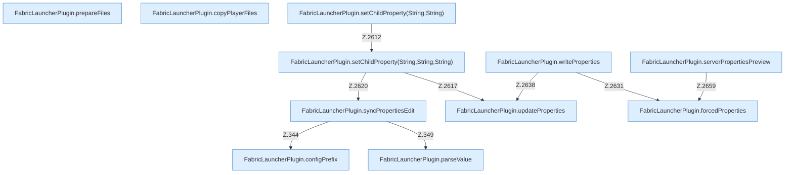

[[00 Start]] › [[Plugin-Kern]] › [[Properties]]

# Properties



```knoten
FabricLauncherPlugin.syncPropertiesEdit
  Gleicht ab `syncPropertiesEdit`. Ruft `profile`, `configPrefix`, `parseValue`.
FabricLauncherPlugin.configPrefix
  `configPrefix` in `FabricLauncherPlugin.java`.
FabricLauncherPlugin.prepareFiles
  Bereitet vor `prepareFiles`. Ruft `firstStable`, `getJson`, `download`.
FabricLauncherPlugin.copyPlayerFiles
  Kopiert `copyPlayerFiles`.
FabricLauncherPlugin.parseValue
  Wertet aus `parseValue`.
FabricLauncherPlugin.setChildProperty(String,String)
  Setzt `setChildProperty`. Ruft `setChildProperty`.
FabricLauncherPlugin.setChildProperty(String,String,String)
  Setzt `setChildProperty`. Ruft `profile`, `directory`, `updateProperties`.
FabricLauncherPlugin.updateProperties
  Aktualisiert `updateProperties`. Ruft `update`.
FabricLauncherPlugin.writeProperties
  Schreibt `writeProperties`. Ruft `forcedProperties`, `hostBindAddress`, `updateProperties`.
FabricLauncherPlugin.forcedProperties
  Erzwingt `forcedProperties`. Ruft `effectiveBindAddress`.
FabricLauncherPlugin.serverPropertiesPreview
  `serverPropertiesPreview` in `FabricLauncherPlugin.java`. Ruft `profile`, `directory`, `open`.
```


